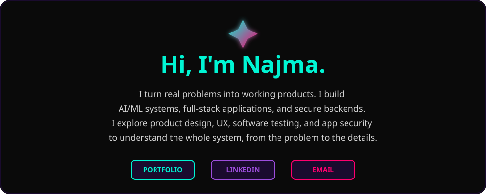
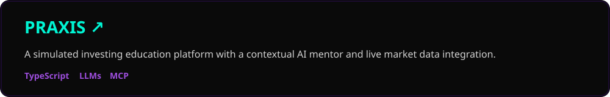
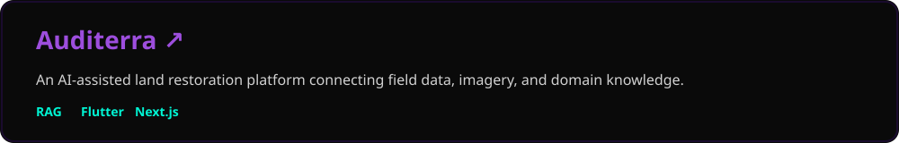
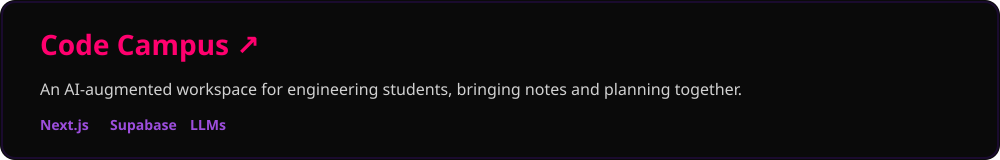
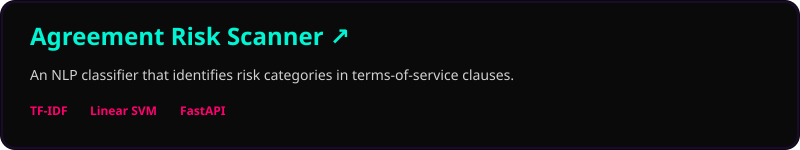
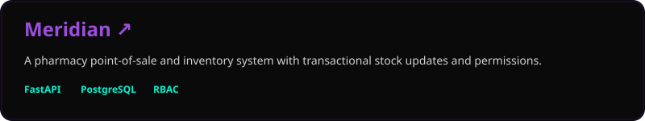
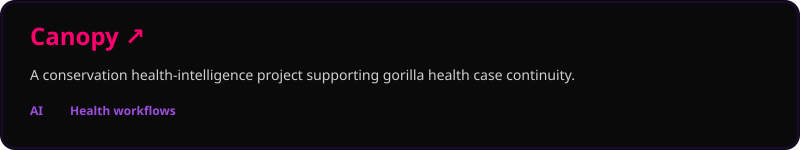
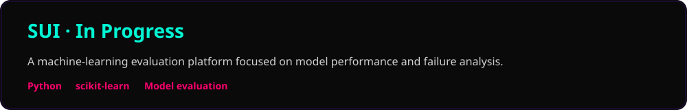

<!-- HERO & ABOUT SECTION -->

  

<h2 style="color: #00f5d4; font-family: 'Fredoka One', sans-serif;">Selected Projects</h2>

<!-- STACKED FULL-WIDTH PROJECT CARDS -->

 

 

 

 

 

 

  

<h2 style="color: #9d4edd; font-family: 'Fredoka One', sans-serif;">Core Tech Stack</h2>
 

  

<h2 style="color: #ff006e; font-family: 'Fredoka One', sans-serif;">Activity</h2>

<!-- RELIABLE STREAK STATS -->

  

<!-- WORKING LINE GRAPH -->

  

<!-- FOOTER -->

